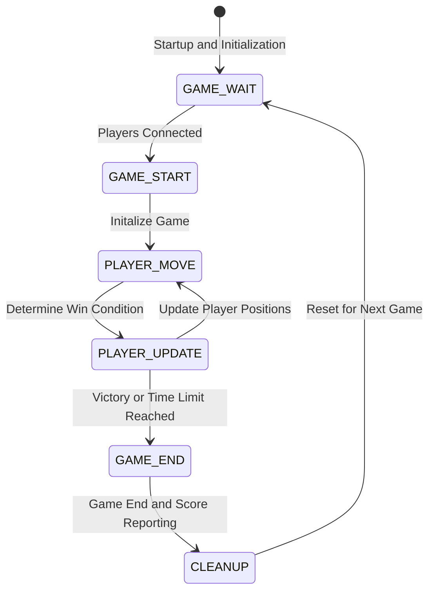
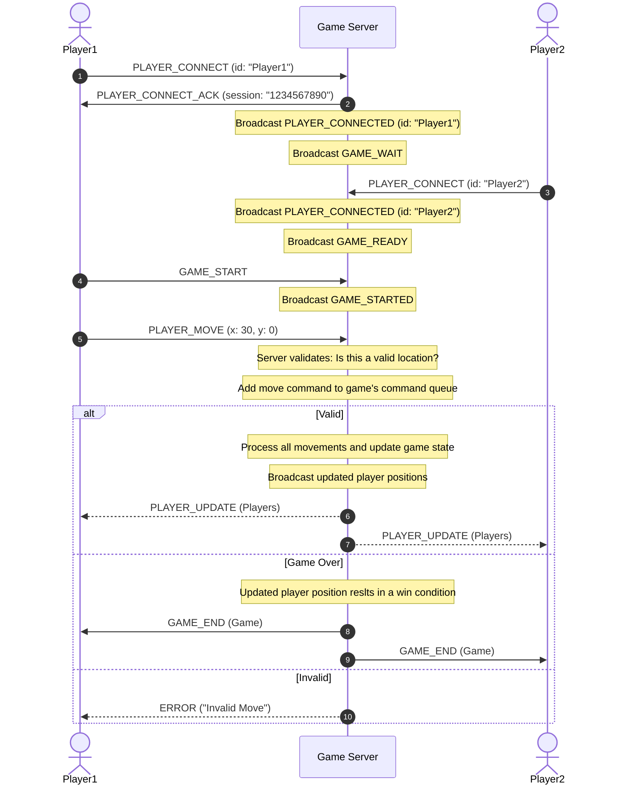

# CS 457 Project Statement of Work (SOW) & Protocol Specification Template

- **Student Name**: Nathan Thompson
- **Date**: 2026-09-18
- **Course**: CS 457 - Computer Networks
- **Target Server Domain**: `server.thompson.edu`

---

## 1. Game Selection & Scope (Sprint 0)

### 1.1. Game Overview

- **Chosen Game**: Terminal Tower, a 2D platformer in the terminal.
- **Player Capacity**: 2 Players, simulated via 2 CML client nodes.
- **Game Summary**: Players race to reach the top of a tower by jumping between platforms and avoiding obstacles while trying to outscore their opponent. Players can score points by collecting items and reaching certain height milestones. The game is designed to be fast-paced and competitive, with a focus on skillful movement and strategic item collection.

### 1.2. Core Game Rules & Win/Draw Conditions

- **Turn Mechanics**: In Terminal Tower, both players can move simultaneously, so there are no traditional turns.
- **Victory Conditions**: The first player to reach the top wins, or if the time limit expires, the player with the highest score wins.
- **Draw/Tie Conditions**: If the time limit expires and both players have the same score, the game ends in a draw.

---

## 2. Protocol Specification (Sprint 1)

### 2.1. Transport Layer & Packet Framing Mechanism

- **Transport Protocol**: This game uses a custom protocol built on top of UDP that can provide reliable or unreliable delivery of game messages. The main determination of whether a message will need to be delivered reliably or unreliably will be explicity stated in a flag in the message header. Reliable messages will be sent over UDP with a custom acknowledgment and retransmission mechanism, while unreliable messages will be sent over UDP without any acknowledgment or retransmission.
    - **Reliable Delivery**: For messages that require reliable delivery, the protocol will implement a simple acknowledgment system to ensure that important messages are received by the client. If a message is not acknowledged within a certain time frame, it will be retransmitted until it is successfully received or a maximum number of retries is reached.
    - **Unreliable Delivery**: For messages that do not require reliable delivery, the protocol will send them without any acknowledgment or retransmission. This allows for faster communication of non-critical game updates like player movements and position updates.
    - **Reasoning**: This choice primarity stems from the curiosity of implementing a custom protocol on top of UDP. The goal is to learn how to implement a reliable protocol on top of an unreliable transport layer, like how we learned throught the rdp protocol and the implementation of QUIC (HTTP/3), but also to gain experience with the challenges and trade-offs involved in doing so.
- **Serialization Format**: Binary encoding with a bit order of big-endian, implemented by a byte buffer.
- **Framing Rule**: Length-Prefixed Framing with the following headers:
    - **Type**: Type of the message, indicated by a predefined set of message types.
    - **Length**: Determines the size and bounds of the message data.

### 2.2. Application Message Types

| Message Type | Transport Protocol | Direction | Description |
|--------------|--------------------|-----------|-------------|
| PLAYER_CONNECT      | Custom (UDP) | Client -> Server | Player requests connection to game server |
| PLAYER_CONNECTED    | Custom (UDP) | Server -> Client | Acknowledgment of player connection |
| PLAYER_DISCONNECT   | Custom (UDP) | Client -> Server | Player disconnects from game server |
| PLAYER_DISCONNECTED | Custom (UDP) | Server -> Client | Acknowledgment of player disconnection |
| GAME_WAIT           | Custom (UDP) | Server -> Client | Game is waiting for two players to connect |
| GAME_READY          | Custom (UDP) | Server -> Client | Game is ready to start |
| GAME_START          | Custom (UDP) | Client -> Server | Player starts the game |
| GAME_STARTED        | Custom (UDP) | Server -> Client | Acknowledgment that the game has started |

| GAME_PAUSE          | Custom (UDP) | Client -> Server | Game is paused |
| GAME_PAUSED         | Custom (UDP) | Server -> Client | Game is paused |
| GAME_RESUME         | Custom (UDP) | Server -> Client | Game is resuming |
| GAME_END            | Custom (UDP) | Server -> Client | Game has ended |
| PLAYER_MOVE         | Custom (UDP) | Client -> Server | Update player position |
| PLAYER_UPDATE       | Custom (UDP) | Server -> Client | Player position updates |

| MESSAGE_PING        | Custom (UDP) | Server -> Client | Ping message for activity and latency check |
| MESSAGE_PONG        | Custom (UDP) | Client -> Server | Pong message for activity and latency check |
| ERROR               | Custom (UDP) | Server -> Client | Error message |

### 2.3. Game Finite State Machine (FSM) Design

### 2.4. Connection Termination & Socket Lifecycle Management

- **Connection Management**: The protocol will implement a simple connection management system, via sessions, to handle player connections and disconnections. When a player connects, the server will assign them a unique session ID and maintain their state in memory for authentication purposes. When a player disconnects, the server will clean up their session and notify the other player of the disconnection. The server will also implement a heartbeat mechanism to detect if a player has disconnected unexpectedly, and will clean up their session accordingly.
- **Graceful Termination**: In a graceful, where a client wishes to disconnect, the client sends a `PLAYER_DISCONNECT` message to the server. This can be done when the player has finished playing or wants to leave the game. The server will then respond with a `PLAYER_DISCONNECTED` message, confirming that the player has been removed from the game and any associated resources have been cleaned up.
- **Abnormal Termination**: If a client disconnects unexpectedly, due to network failure, link failure, or a system crash, the server will be able to detect these events with timeout mechanisms implemented via heartbeats.

### 2.5. AI Prompting & Contraint Strategy

- **AI Prompting**: I will like to setup a custom and provider independent AI harness called Pi. 
- **Constraint Strategy**: Using the Pi harness, I will be able to adjust the AI model's context with specific constraints such as files, command, tooling, and prompting. The customization of Pi through the use of extensions will also become very helpful in constraining and guiding the AI model's behavior to ensure it works within the boundaries I set for it. Additional tricks that I could use to furter constrain the AI model's behaviors will be generic AGENTS.md files for project level constraints, and targeted tasks that I can program in skill.md files.

---

## 3. Concurrency (Sprint 2)

### 3.1. Server Concurrency Model Selection

- **Concurrency Model**: Multi-Threading.
    - A dedicated thread is created for each client session on the server. Each player session will be responsible for processing incoming messages from the client, making updates to the game state, sending responses back to the client, and making sure the player is still active and connected to the game. The main game loop will run on its own thread, waiting for messages to arrive and passing them onto the appropriate player session thread for processing.
    - The shared memory structures will use mutual-exclusion locks, and a message queue to ensure that the game state is updated in a thread-safe manner. The different connection threads will be responsible for adding messages to a message queue, which will be processed in a FIFO manner by the main game loop thread. This will ensure that all messages are processed in the order they were received, maintaining the integrity of the game state.

### 3.2. Client State & Turn Synchronization Scheme

### 3.3. Score & Leaderboard Synchronization Design

- Game state will be stored in a thread-safe data structure within the server's memory. The server will maintain a score table that keeps track of each player's score and position in the game. When a player makes a move, the server will validate the move and update the game state accordingly. The updated score table will then be broadcast to both connected clients to ensure that they have the latest information about their scores and positions.

## Game play, Game State, UI (Sprint 3)

The Session manages communication. The Game manages gameplay.