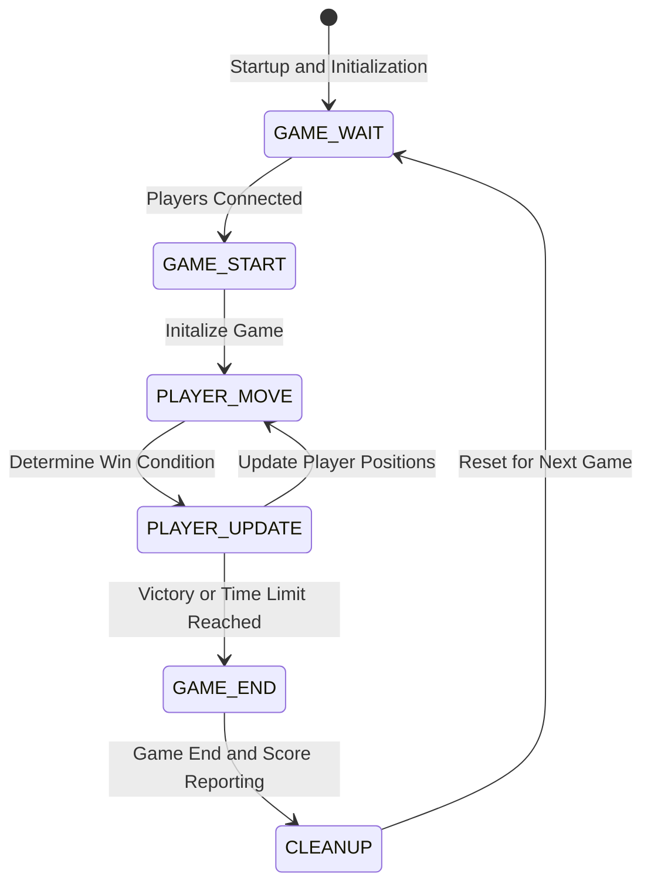

# CS 457 Project Statement of Work (SOW) & Protocol Specification Template

- **Student Name**: Nathan Thompson
- **Date**: 2026-09-18
- **Course**: CS 457 - Computer Networks
- **Target Server Domain**: `server.thompson.edu`

---

## 1. Game Selection & Scope (Sprint 0)

### 1.1. Game Overview

- **Chosen Game**: Terminal Tower (2D Platformer)
- **Player Capacity**: 2 Players (Simulated via 2 CML Client nodes)
- **Game Summary**: Players race to reach the top of a tower by jupping between platforms and avoiding obstacles while trying to outscore their opponent. Players can score points by collecting items and reaching certain height milestones. The game is designed to be fast-paced and competitive, with a focus on skillful movement and strategic item collection.

### 1.2. Core Game Rules & Win/Draw Conditions

- **Turn Mechanics**: In Terminal Tower, both players can move simultaneously, so there are no traditional turns.
- **Victory Conditions**: The first player to reach the top wins, or if the time limit expires, the player with the highest score wins.
- **Draw/Tie Conditions**: If the time limit expires and both players have the same score, the game ends in a draw.

---

## 2. Protocol Specification (Sprint 1)

### 2.1. Transport Layer & Packet Framing Mechanism

- **Transport Protocol**: Combination of TCP and UDP.
    - **TCP**: Used for player connections (CLIENT -> SERVER) and game state synchronization (SERVER -> CLIENT).
    - **UDP**: Used for player movement (CLIENT -> SERVER) and player position updates (SERVER -> CLIENT) where packet loss is acceptable and low latency is prioritized.
- **Serialization Format**: Binary encoding with a bit order of big-endian.
- **Framing Rule**: Length-Prefixed Framing with the following headers:
    - **Length**: Determines the size and bounds of the message data.
    - **Type**: Type of the message, indicated by a predefined set of message types.

### 2.2. Application Message Types

| Message Type | Transport Protocol | Direction | Description |
|--------------|--------------------|-----------|-------------|
| PLAYER_CONNECT      | TCP | Client -> Server | Player requests connection to game server |
| PLAYER_DISCONNECT   | TCP | Client -> Server | Player disconnects from game server |
| GAME_WAIT           | TCP | Server -> Client | Game is waiting for two players to connect |
| GAME_START          | TCP | Server -> Client | Game has started |
| GAME_END            | TCP | Server -> Client | Game has ended |
| PLAYER_MOVE         | UDP | Client -> Server | Update player position |
| PLAYER_UPDATE       | UDP | Server -> Client | Player position updates |
| ERROR               | TCP | Server -> Client | Error message |

### 2.3. Game Finite State Machine (FSM) Design

### 2.4. Connection Termination & Socket Lifecycle Management

- **Graceful Termination**: In a graceful, application layer disconnect, the client sends a `PLAYER_DISCONNECT` message to the server, which acknowledges the disconnection and closes the socket so that infinite recv loops are prevented. This will occur for TCP connections when we recieve a TCP FIN flag, while UDP connections will simply stop sending messages.
- **Abnormal Termination**: If a client disconnects unexpectedly, due to network failure, link failure, or a system crash, the server will be able to detect TCP RST and EPIPE flags, along with basic timeout errors, which will remove the player from the game and cleanup any associated resources if necessary.

### 2.5. AI Prompting & Contraint Strategy

- **AI Prompting**: I will like to setup a custom and provider independent AI harness called Pi. 
- **Constraint Strategy**: Using the Pi harness, I will be able to adjust the AI model's context with specific constraints such as files, command, tooling, and prompting. The customization of Pi through the use of extensions will also become very helpful in constraining and guiding the AI model's behavior to ensure it works within the boundaries I set for it. Additional tricks that I could use to furter constrain the AI model's behaviors will be generic AGENTS.md files for project level constraints, and targeted tasks that I can program in skill.md files.