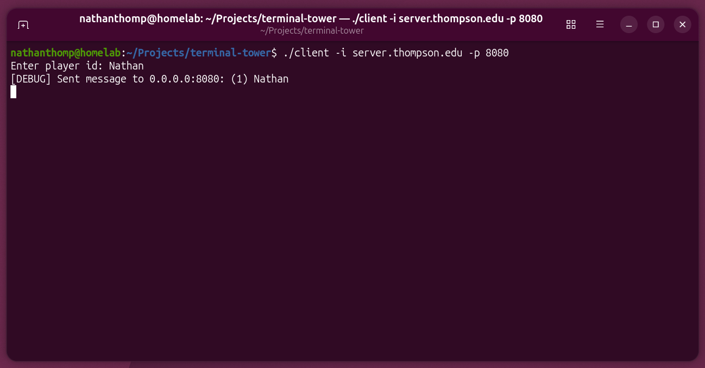
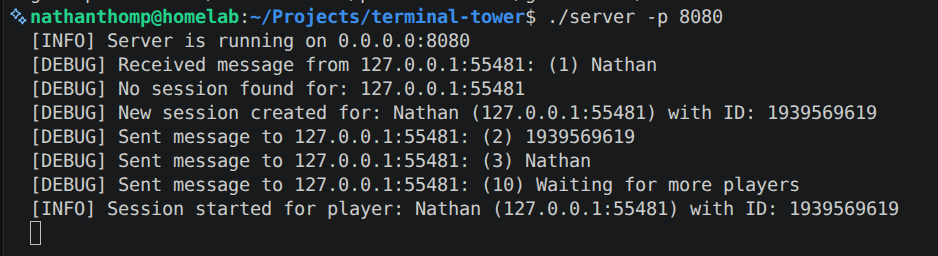
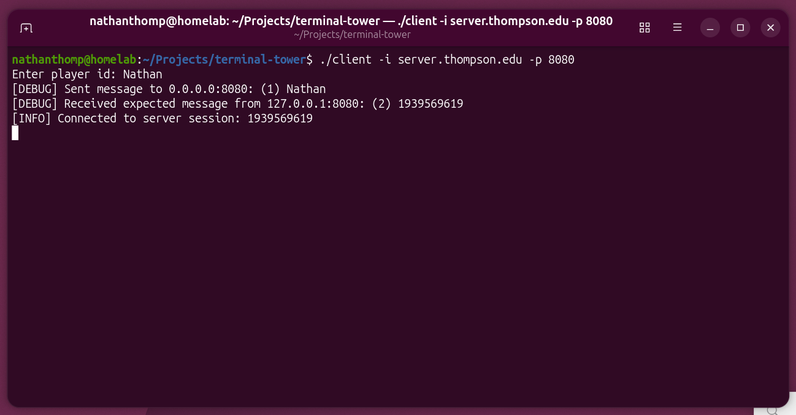
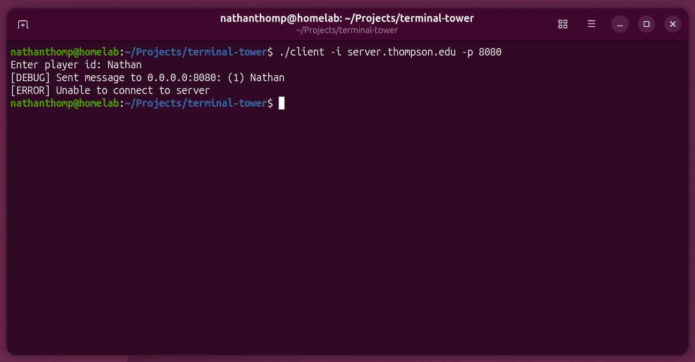
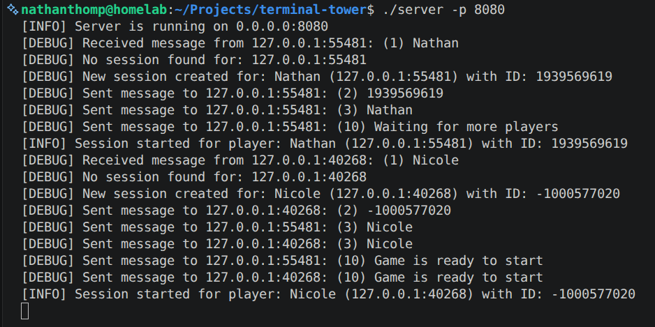
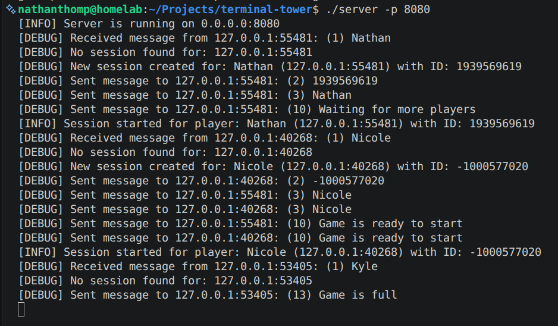

# Intermediate Gameplay Execution Log

This document logs the execution of gameplay events during the intermediate stages of the game.

## Requesting a Connection

The client starts by asking the server to connect player Nathan. The request is sent to the server on port 8080.

## Connection Successful

The server receives the request, creates a session for Nathan, and sends back a session ID. The client then confirms that it is connected to the server.

## Connection Unsuccessful

When the server is not available, the client waits for a response and then reports that it could not connect.

## Multiple Connections

When another player connects, the server creates a second session and tells both players that the game is ready to start.

If another player tries to join after the server is full, the server rejects the request and reports that the game is full.

