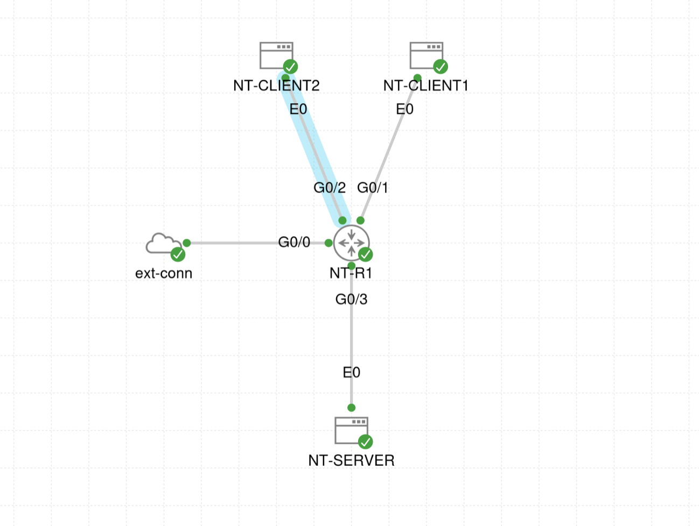
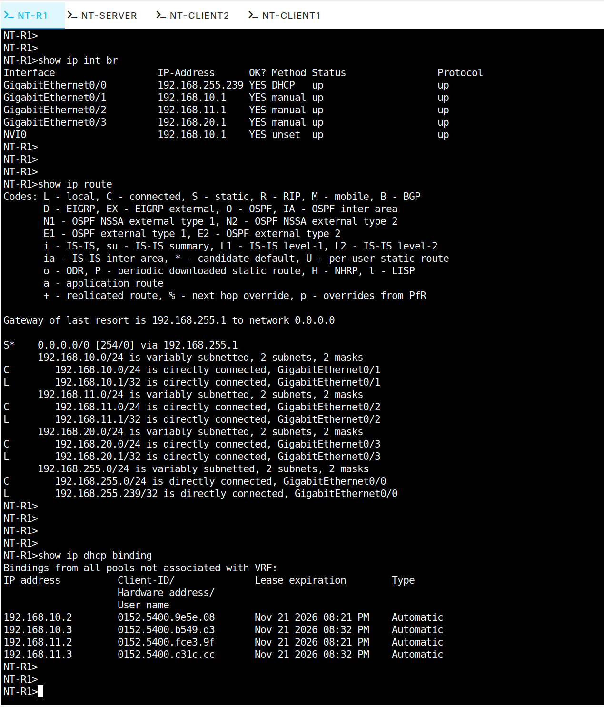
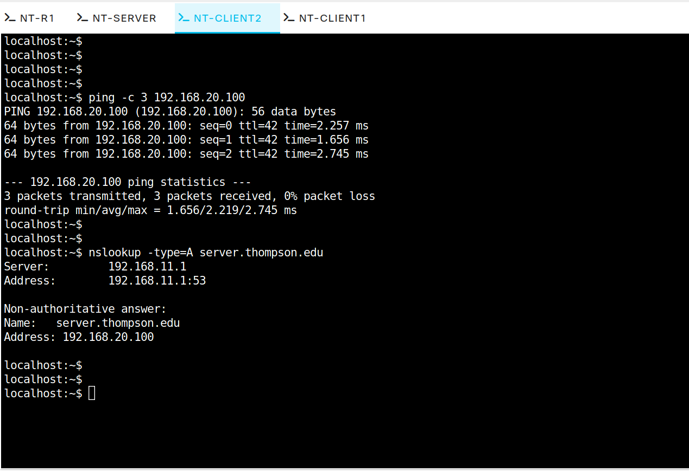
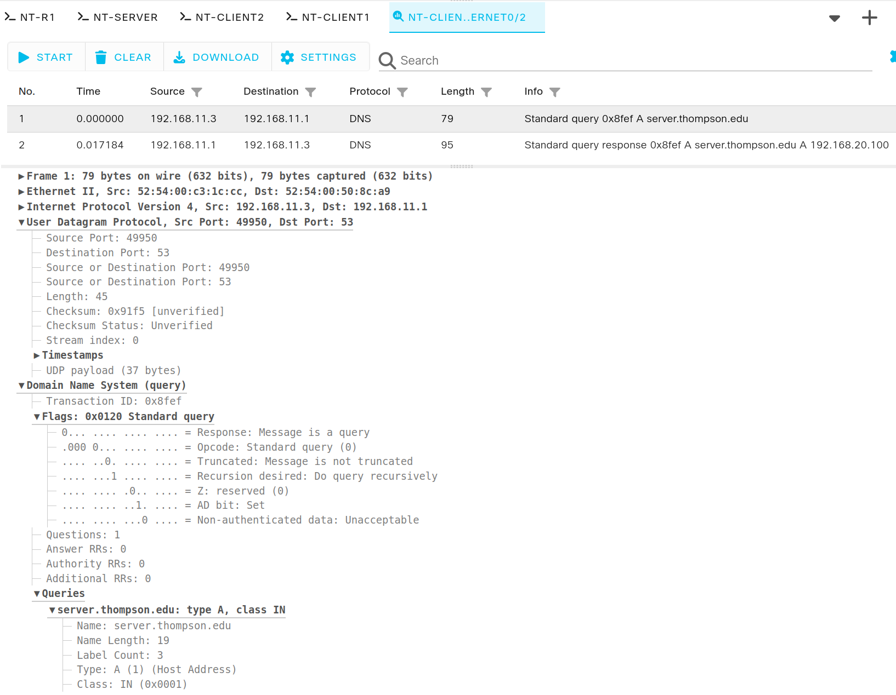
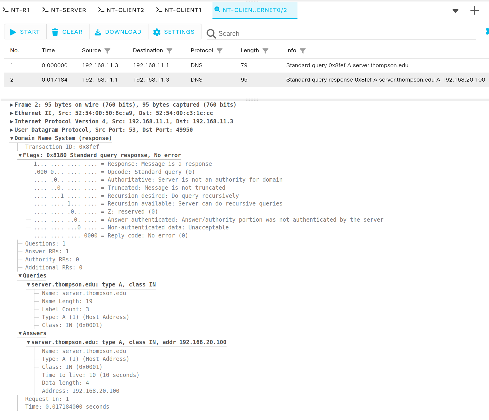

# Sprint 4 Network Report

## Network Topology

*Figure 1: Cisco Modeling Labs (CML) network topology for Sprint 4 showing two clients (NT-CLIENT1 and NT-CLIENT2), a server (NT-SERVER), a router (NT-R1), and an external (WAN) connection. The client NT-CLIENT1 is on the subnet of 192.168.10.0/24 connected to the router (NT-R1) via GigabitEthernet0/1, and the client NT-CLIENT2 is on the subnet of 192.168.11.0/24 connected to the router (NT-R1) via GigabitEthernet0/2. Both of these clients obtain their IP addresses through DHCP, which is configured on the router (NT-R1). The server NT-SERVER is on the subnet of 192.168.20.0/24 and connected to the router (NT-R1) via GigabitEthernet0/3, but has a static IP address of 192.168.20.100. This static address is mapped to the domain name server.thompson.edu, which is configured on the router (NT-R1).*

## Network Verification

### Router CLI Outputs

*Figure 2: Router CLI outputs for Sprint 4 showing the configuration of the router (NT-R1) with the interfaces, IP addresses, and DHCP settings.*

### Client Command Logs

*Figure 3: Client command logs for Sprint 4 showing the results of the ping and nslookup commands.*

### DNS Exchange

*Figure 4: Annotated Wireshark DNS exchange showing the DNS Standard Query (UDP port 53)*

*Figure 5: Annotated Wireshark DNS exchange showing the DNS Standard Response returning 192.168.20.100.*

